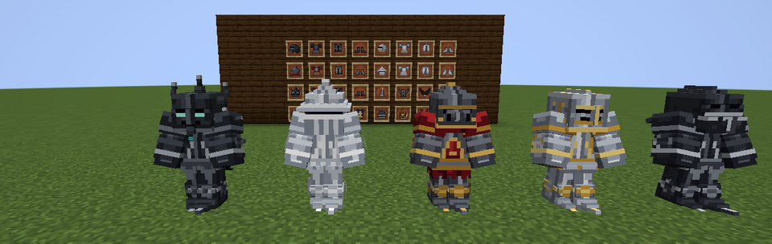
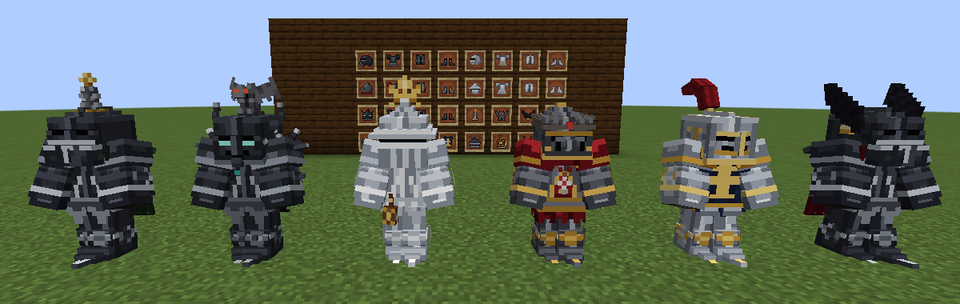
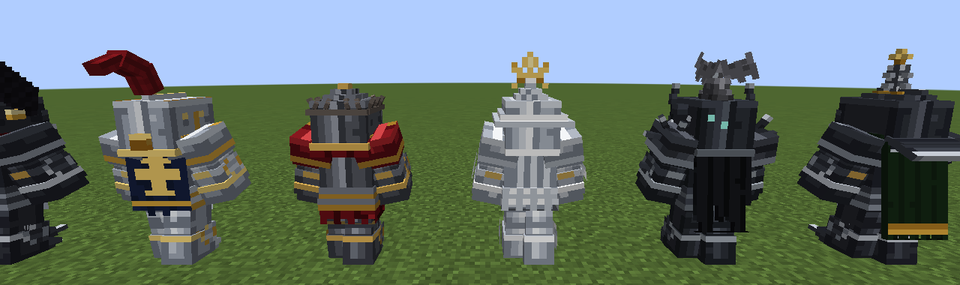
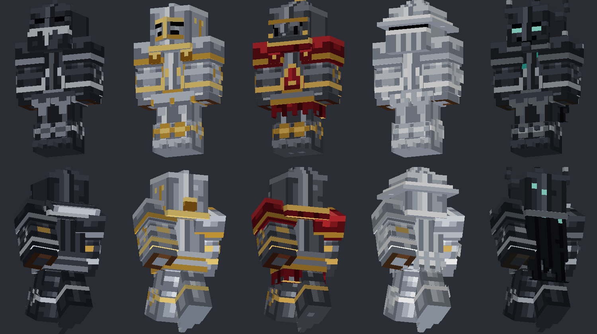
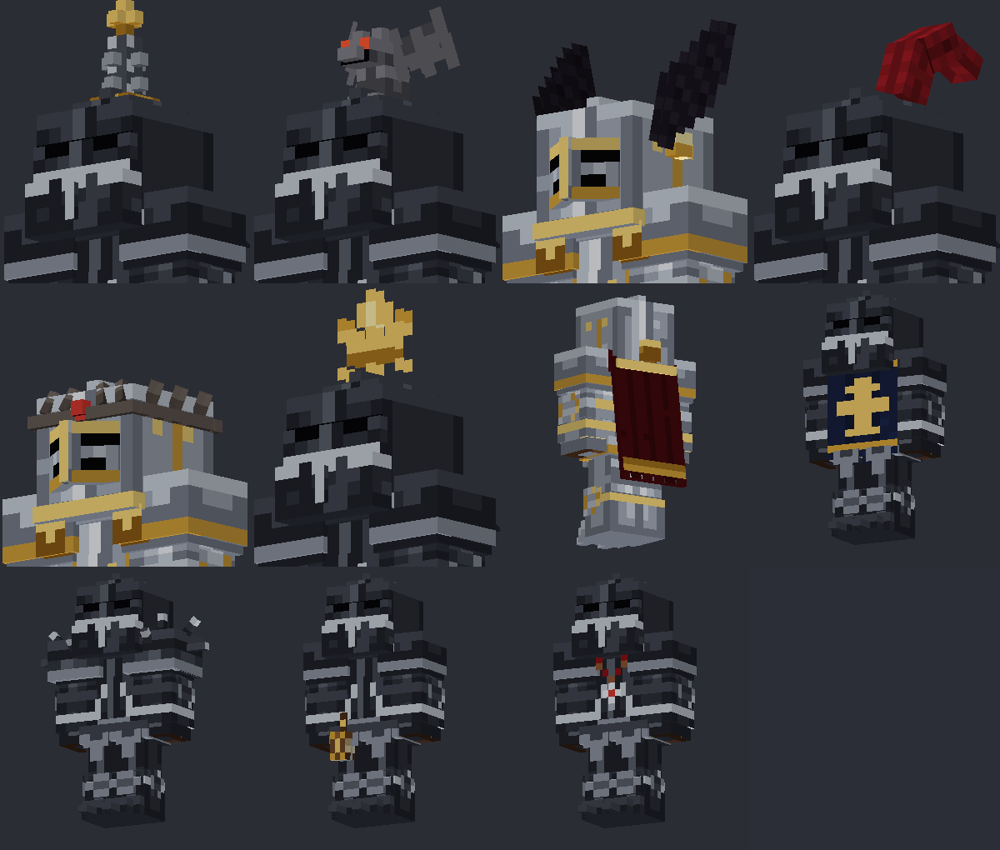
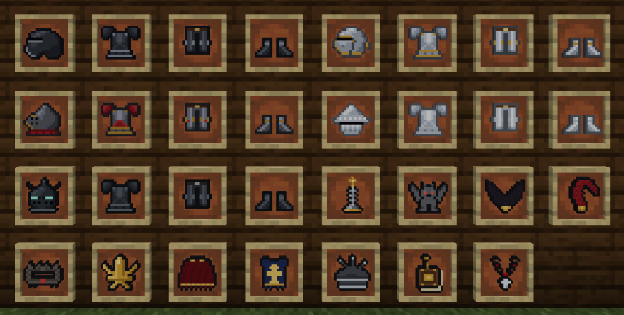

# Epic Knights: Gothic Armory

Аддон к моду **Epic Knights: Shields, Armor and Weapons** для **Minecraft 1.20.1 (Forge)**.
Добавляет пять стилей особой готической брони с бонусами за полный комплект и
одиннадцать готических декораций, которые крепятся к броне так же, как плюмажи
и короны в самом Epic Knights.



Слева направо: призрачный, рифлёный, багровый, позолоченный, чернёный.

## Требования

| Мод | Версия |
|---|---|
| Minecraft | 1.20.1 |
| Forge | 47.x |
| Epic Knights: Shields, Armor and Weapons | 10.15 и новее |
| Architectury API (Forge) | 9.x (нужен Epic Knights) |
| Cloth Config API (Forge) | 11.x (нужен Epic Knights) |

Положите `gothicarmory-1.20.1-1.0.0.jar` в папку `mods` вместе с модами выше.

## Стили брони

Каждый стиль — полный комплект: шлем, кираса, поножи, сабатоны (остроносые латные башмаки).
Все модели трёхмерные: веерные налокотники и наколенники, пластины-тассеты, фаулды,
остроносые сабатоны, у каждого стиля свой шлем.

| Стиль | Шлем | Вид | Бонус полного комплекта |
|---|---|---|---|
| **Чернёный** (Blackened) | Салад с хвостом и бевором | Чернёная сталь, полированная кромка | **Ужас:** удары в ближнем бою накладывают Слабость |
| **Позолоченный** (Gilded) | Армет с «клювом» и ронделью | Зеркальная сталь, золотая гравировка | **Золотая слава:** Удача; пиглины не нападают (как на золотую броню, хватает одной вещи). Высокая зачаровываемость |
| **Багровый** (Crimson) | Большой бацинет с забралом-«носом» | Багровый лак, бархатная юбка и воротник | **Кровавый обет:** удары лечат на 20% нанесённого урона |
| **Рифлёный** (Fluted) | Шапель (железная шляпа) с бевором | «Белый доспех», покрытый рифлением | **Отражение:** на 35% меньше урона от стрел и других снарядов. Самый прочный |
| **Призрачный** (Wraith) | Армет со шпилем и рогами-полумесяцами | Пепельная сталь, светящиеся руны, рваный плащ | **Призрачный страж:** ночное зрение, иммунитет к Иссушению |

Прочность и защита — уровень алмазной брони (защита 3/8/6/3, прочность выше, чем у
готического доспеха Epic Knights). Чинится стальными слитками (позолоченный — золотыми).
В подсказке к предмету видно, сколько частей комплекта сейчас надето.

### Крафт

Особая броня перековывается из готической брони Epic Knights на верстаке —
деталь Epic Knights в центре (`X`), вокруг материалы стиля:

| Стиль | Рецепт | Базовый шлем |
|---|---|---|
| Чернёный | 2 стальные пластины (сверху/снизу) + 2 угля (по бокам) | Салад |
| Позолоченный | 2 золотых слитка + 2 золотых самородка | Армет |
| Багровый | красная шерсть + 2 красных красителя + золотой самородок | Бацинет |
| Рифлёный | 3 стальные пластины + стальной самородок | Шапель |
| Призрачный | 2 мембраны фантома + 2 блока песка/почвы душ | Армет |

Кираса, поножи и сабатоны делаются из `Готический доспех`, `Готические поножи` и
`Готические ботинки` Epic Knights по тем же схемам.

## Декорации




Декорация крепится к **любой** броне (своей, Epic Knights или ванильной):
положите деталь брони и декорацию на верстак. На одну деталь можно повесить
до 8 декораций; снимаются они так же, как в Epic Knights. Плащ, табард, плюмаж и
вороньи крылья можно перекрашивать красителями, как кожаную броню.

| Декорация | Куда | Рецепт |
|---|---|---|
| Готический шпиль | шлем | золотой самородок + железный слиток + стальная пластина (столбиком) |
| Горгулья | шлем | 2 камня + резной каменный кирпич |
| Вороньи крылья (красятся) | шлем | 4 пера + чёрный краситель + железный самородок |
| Готический плюмаж (красится) | шлем | перо + красная шерсть + золотой самородок (столбиком) |
| Терновый венец | шлем | 5 железных самородков + мёртвый куст |
| Гребень «Флёр-де-лис» | шлем | 4 золотых самородка + золотой слиток |
| Готический плащ (красится) | кираса | 6 красной шерсти + 2 золотых самородка |
| Готический табард (красится) | кираса | 7 синей шерсти + золотой слиток |
| Шипастые наплечники | кираса | 2 стальные пластины + 2 стальных самородка |
| Поясная книга | кираса | книга + цепь + золотой самородок |
| Чётки | кираса | нить + 2 деревянные кнопки + железный самородок |

Все предметы есть во вкладке творческого режима «Готическая оружейная», а также во
вкладках брони и декораций Epic Knights. Там же лежат несколько уже украшенных
вещей для примера.

## Галерея

| Модели (превью генератора) | Декорации крупно |
|---|---|
|  |  |



## Настройки

`config/gothicarmory-common.toml`: включение бонусов комплектов, длительность Слабости
(чернёный), доля вампиризма (багровый) и снижения урона от снарядов (рифлёный).

## Сборка из исходников

```bash
./gradlew build
# готовый мод: build/libs/gothicarmory-1.20.1-1.0.0.jar
```

Нужна JDK 17 (Gradle скачает её сам через toolchain). Epic Knights подключается из
Maven-репозитория Modrinth, Architectury и Cloth Config — из их репозиториев.

### Как устроены модели и текстуры

Модели брони и декораций, их текстуры, иконки, JSON-модели предметов, рецепты и
локализации (ru/en) генерируются скриптом из описаний в `tools/gothic/`:

```bash
pip install numpy pillow
python3 tools/gen_assets.py --previews
```

- `tools/gothic/armor.py` — геометрия и раскраска пяти стилей брони;
- `tools/gothic/decorations.py` — декорации;
- `tools/gothic/icons.py` — пиксель-арт иконок 16×16;
- `tools/gothic/content.py` — названия, рецепты, бонусы;
- `--previews` перерисовывает картинки в `docs/`.

Скрипт сам раскладывает UV-развёртку, пишет `GothicLayers.java` (определения моделей)
и PNG-текстуры, поэтому их не нужно править вручную.

Предметы регистрируются через API аддонов Epic Knights (`ModItemsProvider`,
`ModModelsProvider`), поэтому броня и декорации рисуются его же рендером и
совместимы с его системой украшений.
